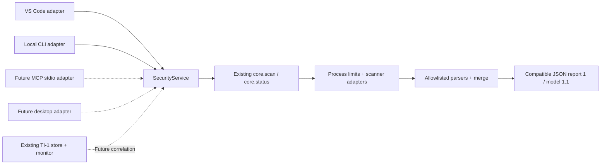

# Shared Security Core — incremental implementation

검증 기준: 2026-10-28, main `144827579c35d4656ef91a47d438fc411df053f4` / v0.3.0. 원격 main과 로컬 HEAD를 `git ls-remote`로 읽기 전용 대조했습니다. 요청서의 v0.2.0 이후 TI-1이 이미 포함되어 있습니다.

## 현재와 이번 변경

| 영역 | 확인한 상태 |
|---|---|
| 스캐너 | Semgrep CE/OSV/Gitleaks/Trivy, 로컬 복사본, JSON 파서, 중복 병합, timeout/cancel, 미설치/실패 구분 |
| VS Code | 명령·진행률·Problems·소스 위치 이동·로컬 보고서 |
| TI-1 | CISA/GitHub/OSV 공개 메타데이터 수집, SQLite, 변경 이력, 열린 VS Code의 일일 갱신 |
| 프로젝트 영향 | inventory/생태계별 버전 비교/공격 전제/정적 도달 경로 미구현. NOT_ANALYZED 유지 |
| MCP | 이번 단계는 계약·설계와 공유 서비스 경계 검증. SDK/서버/실제 연결은 미구현 |
| 배포 | Marketplace/VSIX/CI 실행/예약 작업/원격 게시 미수행. 별도 readiness 문서 참고 |

기존 JavaScript/CJS와 `src/core.js`의 `scan(root, options)`를 유지합니다. Python/TypeScript 재작성이나 별도 분석 엔진은 없습니다.



구현 API는 `src/security-service.js`의 `createSecurityService(config)`입니다. `src/report-model.js`가 additive 모델 표식을 적용하고, 기존 `src/parsers.js`가 안전한 스캐너 메타데이터를 제공합니다. 확장과 CLI가 이 서비스를 통해 같은 `scan()`을 호출합니다.

## Trusted host configuration / request boundary

```javascript
const {createSecurityService} = require('./src/security-service');
const service = await createSecurityService({
  workspaces: [{id: 'app', root: absoluteWorkspacePath}],
  scannerOptions: {
    executables: trustedExecutablePaths,
    reportDir: externalLocalReportDirectory,
    cacheDir: trivyOfflineCache,
    osvCacheDir: osvOfflineCache,
    timeout: 120000
  }
});
const local = await service.scanWorkspace({workspaceId: 'app'}, {signal});
const header = service.getReport({scanId: local.scanId});
const page = service.getFindings({scanId: local.scanId, offset: 0, limit: 50});
```

`config`는 VS Code 사용자 설정, 로컬 CLI 실행자 또는 향후 MCP 시작 설정이 정하는 신뢰 경계입니다. 요청 payload가 아닙니다. 작업 공간 등록 시 canonical realpath를 저장하고 실행 직전에 다시 대조합니다. 요청에서는 workspace ID만 받으며 root/file 경로, 실행 파일, shell 명령, args, 출력/캐시 경로, 패치/쓰기 플래그를 받지 않습니다. unknown key, 잘못된 타입/정수/ID를 거부합니다.

| 메서드 | request | 결과/제한 |
|---|---|---|
| scannerStatus | `{}` | 기존 상태 모델에서 executable 절대 경로·알려지지 않은 필드 제외 |
| scanWorkspace | `{workspaceId, timeoutMs?}` | `{report, reportFile, scanId, workspaceId, execution}`. **로컬 호스트용 전체 결과** |
| getFindings | `{scanId, offset?, limit?}` | 최대 100개, 기본 50개, nextOffset/total 명시 |
| getReport | `{scanId, includeFindings?}` | 기본은 header + findingsIncluded:false + totalFindings. 전체 포함은 명시적 요청 및 byte 한도 이내 |

`scanId`는 무작위 UUID이고 서비스가 생성한 메모리 결과만 조회합니다. 입력한 report 경로나 임의 파일을 읽는 API가 없습니다. 기본 최근 3개/JSON 직렬화 64 MiB 한도로 보관하고 만료 ID는 report_not_found입니다. 조회 결과는 복제하므로 호출자가 내용을 바꿔 저장된 결과를 오염시키지 못합니다. 재시작 후 ID 조회는 지원하지 않습니다.

각 조회/status 값의 기본 byte 상한은 UTF-8 JSON **256 KiB**입니다. 초과 시 result_limit을 반환하고 페이지 크기를 줄이거나 로컬 보고서를 사용해야 합니다. 한 finding 자체가 너무 큰 경우도 조용히 잘라 완전한 결과로 표시하지 않습니다. `scanWorkspace()`의 전체 결과는 로컬 UI/CLI용이므로 미래 MCP는 직접 전송하지 말고 bounded 조회 envelope로 바꿔야 합니다. reportFile은 MCP에 전송하지 않습니다.

한 서비스 인스턴스에서 동시 스캔 1개입니다. 요청 timeout은 호스트의 도구별 한도를 늘릴 수 없습니다. 전체 기한은 기본 `min(600000, 4 * scannerTimeout + 125000)` ms이고 caller AbortSignal과 결합합니다. 버전 probe는 실행 파일 디렉터리에서 최대30초이며, Python 기반 Semgrep의 느린 호스트 초기화를 고려한 한도입니다. execution.status에서 timeout/cancelled/completed를 구분합니다. completed는 호출이 반환됐다는 뜻이며 scanner 성공 여부는 항상 report.scanners/coverage를 확인합니다. 프로세스가 abort를 따르지 않는 경우의 강제 격리 보장은 아래 제한에 해당합니다.

## 결과 모델: schemaVersion 1 + modelVersion 1.1

기존 파일/줄/rule/package/severity/kind/aliases/scanners/message/id, coverage, limitations를 유지하고 필드를 추가합니다. schemaVersion은 **1**이고 modelVersion은 **1.1**입니다. 기존 소비자가 모르는 필드를 무시하면 기존 보고서를 계속 읽을 수 있습니다. old v1 문서는 `withReportMetadata()`로 null/unknown/빈 목록을 보완할 수 있습니다. 원본 legacy 객체와 ID를 바꾸지 않습니다. 향후 필드 삭제나 의미 변경은 schemaVersion 상승 및 migration이 필요합니다.

| 추가 필드 | 의미 |
|---|---|
| packageDetails | ecosystem/name/detectedVersion/purl 및 출처별 observations. 비의존성은 null |
| vulnerability | id, affectedRanges, fixedVersions, advisorySources |
| evidence | scanner/type/file/line/rule만 포함. source text, match, 비밀값 없음 |
| impact | status=NOT_ANALYZED, confidence=unknown. 스캐너 탐지와 프로젝트 공격 가능성 판정을 구분 |
| finding.limitations | 빠진 버전/범위/수정 버전, 메타데이터 한도/상충값, 미분석 영향 |

OSV의 명시된 ecosystem/version/purl 및 해당 패키지의 affected 범위·fixed event를 사용합니다. 다른 패키지의 범위를 붙이지 않습니다. Trivy는 InstalledVersion/PURL/FixedVersion/DataSource를 사용하고, 직접 제공하지 않은 ecosystem은 null로 둡니다. 원시 Type(pip 등)은 scannerPackageType 관찰 값으로 남기며 자동으로 생태계 이름을 추정하지 않습니다. GIT 범위 fixed hash를 패키지 수정 버전으로 바꾸지 않습니다.

합쳐진 결과에서 알려진 단일 값만 공통 값으로 유지하고, 서로 다른 버전/생태계 관찰은 null + 원래 observations + conflicting limitation으로 표시합니다. fixedVersions는 여러 유지보수 분기의 후보 목록이지 무조건 설치할 추천 버전이 아닙니다. 생태계별 버전 비교와 안전한 업그레이드 제안은 TI-2의 후속 책임입니다.

출처 URL은 표시용 provenance이며 자동으로 fetch하지 않습니다. credential URL·사설 literal 주소·query/fragment와 알려진 토큰 형식을 제거합니다. 원시 메시지/Description/Match/Secret/코드 조각은 추가하지 않습니다. metadata extraction 한도에 도달하면 limitation을 남깁니다.

## 호환성 예외와 보안 보강

실제 직접 엔진/CLI 비교에서 Semgrep 기본 rule ID rewriting이 임시 폴더명을 ID에 넣어 매번 ID가 달라지는 문제를 발견했습니다. 공식 `--no-rewrite-rule-ids`와 설치된 CLI 도움말을 확인하여 적용했습니다. 이제 번들 YAML의 ID가 그대로 유지됩니다. **기존 경로 접두사가 있던 Semgrep rule/id와 새 결과의 ID는 달라질 수 있습니다.** old JSON 자체는 계속 읽을 수 있고 다른 finding의 ID 알고리즘은 바꾸지 않습니다. 근거: [Semgrep CLI](https://docs.semgrep.dev/cli-reference).

snapshot/read result의 stat 이후 파일이 커지는 문제를 줄이기 위해 실제 읽는 byte를 cap+1까지 제한하고, 실제 복사 byte를 총량에 집계합니다. 5 MiB 파일 한도/100 MiB snapshot/32 MiB 결과 읽기 한도를 유지합니다.

현재 한계:

- raw scanner `--output` 파일은 종료 후 읽기 한도를 확인합니다. 실행 도중 디스크 쿼터를 강제로 제한하는 기능은 없습니다.
- 심볼릭 링크/realpath 방어는 신뢰된 로컬 workspace 경계이며, 적대적인 동시 파일 교체를 완전히 차단하는 OS sandbox가 아닙니다.
- 취소는 프로세스 종료와 cooperative abort에 의존합니다. Windows 강제 종료 실패·자손 프로세스 전부 종료·영원히 close하지 않는 프로세스까지 보장하는 격리 worker는 아직 없습니다. MCP 배포 전 hard-deadline/자손 종료 테스트와 격리를 추가해야 합니다.
- 서비스의 byte/보관 한도는 MCP 프로토콜 frame 크기 제한을 대체하지 않습니다. stdio adapter에서 별도 frame 검증이 필요합니다.

## CLI와 검증

기존 `npm.cmd run scan -- <project> [reportDirectory]` 사용법을 유지합니다. CLI는 신뢰된 로컬 실행자 설정으로 `SENTINEL6_SEMGREP`, `SENTINEL6_OSV`, `SENTINEL6_GITLEAKS`, `SENTINEL6_TRIVY` 실행 파일 경로와 `SENTINEL6_TRIVY_CACHE`, `SENTINEL6_OSV_CACHE` 절대 캐시 경로를 받을 수 있습니다. 이것은 MCP 요청 인수가 아닙니다.

```powershell
npm.cmd test
npm.cmd run check
# 준비된 .tools / .cache를 사용하는 실제 스캐너 검사
node scripts/live-test.js
node scripts/verify-shared-core.js
.\scripts\test-vscode.ps1
```

직접 엔진/CLI/VS Code의 실행 시각·duration만 제외하고 finding ID·추가 메타데이터·coverage·범위를 비교합니다. SDK 프로토콜/실제 Codex 연결 테스트는 이번 범위가 아닙니다. 현재 결과는 [검증 기록](shared-core-validation.md), 다음 단계는 [실행 계획](next-development-plan.md)을 참고하세요.
