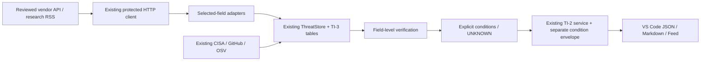

# TI-3 Security Intelligence design

기준 main/원격 main: 19aacc82aebb1054a81de397426031b4dd080529 / v0.3.0, 시작 clean, baseline 145개 통과. JavaScript와 기존 SecurityService/ThreatMonitor/ThreatStore/ImpactService를 유지합니다.

구현 순서: 검토된 adapter → 출처별 주장·CVE 연결 → 명시적 공격 조건 → 별도 버전의 프로젝트 조건 근거 → VS Code JSON/Markdown → DB/회귀 검증입니다.

새 수집은 사용자 전역 opt-in을 사용하고 기존 daily scheduler/HTTP 클라이언트를 재사용합니다. 고정 Red Hat Security Data API와 Cisco Talos RSS만 추가하며 arbitrary URL·크롤링·유료 AI·원본 변경·설치·셸 실행을 허용하지 않습니다. Red Hat 선택 메타데이터에는 CC BY 4.0 attribution/원문 링크를 보존합니다. Talos는 제목/URL/식별자 사실만 저장하고 기사 본문은 저장하지 않습니다. NVD/KISA는 미지원으로 명시합니다.

공식 메타데이터, 연구기관 보도, 특정 프로젝트에서의 조건 확인은 별도입니다. CVSS/CWE만으로 인증·특정 함수·공격 성공을 추측하지 않습니다. TI-2의 CONFIRMED_AFFECTED는 계속 구성요소 선언/잠금 버전 일치이며 TI-3 조건을 덧붙여도 의미를 바꾸지 않습니다. 여러 출처의 충돌·범위 차이·공식 alias·철회·미확인 조건을 보존합니다. MCP/TI-4/TI-5/배포/OS scheduler는 이번 범위에서 제외합니다.

## 현재 흐름과 API

- `registry.descriptors`, `allowed()`, `documentUrl()`는 검토된 provider·요청 경로·표시 URL 정책입니다. 새 adapter는 registry의 고정 정책, collector의 명명된 함수 map, schema/rules/tests를 함께 변경해야 합니다. URL/collector를 workspace 설정·RSS·외부 문서가 등록할 수 없습니다.
- `adapters.redhat(text, expectedCve, now)`, `rss(text, now)`는 원시 응답을 선택 메타데이터로 변환하고 버전/정규화 fingerprint를 부여합니다. `validation.validateSource()`가 source authority·identity·enum·허용 키·fingerprint를 검증합니다.
- `verification.verify(id, documents)`는 주장별 출처/제품 범위를 비교합니다. `conditions.attackConditions(id, verification)`는 별도 조건 모델을 반환합니다.
- `IntelligenceService.analyze(id,{signal})`, `report(id,{format,projectAssessments})`는 캐시 기반 로컬 API입니다. HTTP 수집이나 임의 명령을 실행하지 않습니다. `format`은 json/markdown입니다.
- 기존 `ThreatMonitor`는 `newsEnabled`, `refreshNews()`와 source adapter를 추가했으며 기존 단일 in-flight 작업·daily timer·cooldown을 재사용합니다. 별도 daemon/timer는 없습니다.
- 기존 `SecurityService.configurationFacts({workspaceId},{signal})`는 등록된 workspace의 고정 `.npmrc` 사실만 반환합니다. 요청에 파일 경로·명령을 넣을 수 없습니다.

## 실제 지원 출처와 범위

| 출처 | 공식 인터페이스 | 처리 범위 |
|---|---|---|
| 기존 CISA KEV / GitHub reviewed / OSV | 기존 API/index | 그대로 유지, 기존 공식 alias/KEV/범위/수정 버전 근거 재사용 |
| Red Hat Product Security | `access.redhat.com/hydra/rest/securitydata/cve.json`, `/cve/CVE-….json` | 공개일 window·20개 목록 page, 기본 실행당 상세 5개, 이전 관찰 CVE 최대 10개를 cycle마다 일부 재확인 |
| Cisco Talos 공식 연구 블로그 | `blog.talosintelligence.com/rss/` | 현재 RSS 항목. 제목·원문 URL·날짜·언급 ID·제한된 제목상 악용 주장만 저장 |
| NVD / KISA | 미구현 | disabled; 연동 조건 검토와 별도 adapter 검증이 필요 |
| 다른 공급업체·보안 매체 | 미구현 | 임의 URL/HTML/기사 크롤링으로 대체하지 않음 |

Red Hat의 공개일 목록은 수정일 feed가 아닙니다. 관찰하지 않은 과거 CVE의 변경을 모두 포착하지 않으며, 관찰 목록의 표본 재확인도 완전한 모니터링 보장이 아닙니다. 초기 window는 기존 monitor의 최근 7일, page/상세 예산을 넘기면 continuation·partial·이전 last_success를 유지합니다. RSS는 publisher의 현재 window 밖 기사나 기사 본문 수정을 확인하지 않습니다.

Red Hat의 `details`는 MITRE 등 다른 원천일 수 있어 조건 확정에는 사용하지 않습니다. `statement`, `cwe`, 검증된 `cvss3`, 제품/package state, 제공된 fix/mitigation 필드만 선택합니다. CVSS v4, draft metric, 미지원 문장/언어는 추측하지 않습니다. 공급업체 src.rpm 수정 패키지/자유 형식 upstream_fix를 npm/PyPI의 정확한 수정 버전으로 바꾸지 않습니다.

Red Hat 데이터는 [공식 데이터 정책](https://access.redhat.com/security/data)의 CC BY 4.0 attribution과 원문 링크를 각 source record/보고서에 보존합니다. Talos는 기사 본문/요약 문장을 복제하지 않고 제목·링크·식별자 사실만 저장합니다. RSS 설명은 메모리에서 제한된 식별자 확인 후 버립니다. 사용자 프로젝트의 목록/소스/설정은 두 provider에 전송하지 않습니다.

## 출처 검증

각 claim에는 field/value, 원문 필드 path, product scope, authority, source ID/URL, 공개/수정/관찰 시각과 현재/철회 상태가 있습니다. 상태는 OFFICIAL_CONFIRMED, MULTI_SOURCE_CORROBORATED, SINGLE_SOURCE_REPORTED, CONFLICTING_INFORMATION, UNVERIFIED입니다. 수집 직후의 원시 정규화 source는 UNVERIFIED이며, 검증 결과는 별도 분석 모델의 field별 상태로 확인합니다.

같은 scope에서 인증·필요 권한·표면·필수 설정 값이 상충하면 양쪽 주장을 보존하고 UNKNOWN을 반환합니다. 제품 범위가 다르면 섣불리 모순으로 처리하지 않습니다. 버전 구문/분기별 수정 버전이 텍스트상 다르다는 이유만으로 충돌이라 하지 않으며 실제 감지 버전 비교는 기존 TI-2가 담당합니다.

GitHub/OSV 메타데이터는 보수적으로 같은 `vulnerability-metadata` origin으로 집계해 미러를 독립 확인 2개로 세지 않습니다. 실제 독립 출처의 동일 주장은 field/scope별로 corroborated가 됩니다. 공식 metadata는 해당 필드의 출처 근거이며, 공급업체 제품·실제 프로젝트까지 모두 검증됐다는 뜻이 아닙니다.

뉴스의 CVE/GHSA 동시 언급은 alias가 아닙니다. 기존 ThreatStore가 확인한 단일 CVE/공식 관계만 canonical 연결에 사용합니다. 미확인 CVE 또는 ID 없는 기사는 UNVERIFIED/별도 NEWS ID로 유지합니다. CVE 등록 기관을 실시간 검증했다고 표시하지 않습니다.

악용 상태는 CONFIRMED_EXPLOITED / REPORTED_EXPLOITATION / PROOF_OF_CONCEPT_ONLY / NOT_CONFIRMED / UNKNOWN입니다. CISA KEV 또는 정확한 공식 확인은 confirmed, 제한된 긍정 RSS 제목은 reported/PoC입니다. 부정·의문·가능성 제목은 확정하지 않습니다. 공급업체의 not-confirmed는 KEV 확인을 취소하거나 악용 부재를 증명하지 않습니다.

## 조건 분석과 프로젝트 연결

분류 taxonomy 15개를 제공합니다. CWE-89/78/287/862/918/22/502/269/200/434는 각각 SQL Injection, Command Injection, Authentication Bypass, Authorization Bypass, SSRF, Path Traversal, Insecure Deserialization, Privilege Escalation, Sensitive Information Disclosure, Insecure File Upload의 **분류** 근거입니다. RCE·Supply Chain Compromise·Container/MCP Permission Misconfiguration·AI Agent Sandbox Exposure는 공식 제목의 명시적 표현을 제한적으로 분류합니다. 분류만으로 인증·필수 공격 경로·함수·구체적인 원인을 생성하지 않습니다.

조건을 확인하는 현재 범위는 Red Hat statement의 완결된 명시적 영어 문장입니다. `Exploitation requires authentication.` / `does not require authentication.`, `requires a custom authentication adapter to be enabled.`, `requires npm lifecycle scripts to be enabled.` 및 명시적 부정 형태를 지원합니다. 이를 포함한 인용·조건부/부정 문장을 무조건 참으로 파싱하지 않습니다. 일반 자연어/모든 공급업체/모든 공격 조건 추출은 미지원입니다.

Red Hat verified CVSS 3.0/3.1의 PR/AV/UI/C/I/A는 필요 권한·지표상 공격 표면·사용자 상호작용·잠재 영향으로 보존합니다. PR:N만으로 인증 필요 여부를 추측하지 않으며, NETWORK도 현재 프로젝트의 인터넷 노출 증거가 아닙니다. 인증 정보가 없으면 UNKNOWN입니다. trust_boundary/기능·정확한 호출 위치는 실제 근거가 없으면 null/빈 배열입니다.

TI-2의 기존 match와 impact_status/fingerprint 의미는 유지합니다. 별도 `security_intelligence: {schemaVersion:1, modelVersion:'ti-3.0', items}`에 공식 조건·공급업체 scope·현재 프로젝트 확인 수준을 붙입니다. inventory+관련 advisory fingerprint에 TI-3 fingerprint와 필요한 config 사실을 추가해 관련 변경만 재평가합니다. 무관한 뉴스로 프로젝트를 재검사하거나 위험 알림을 만들지 않습니다.

`.npmrc`의 단일 명시 `ignore-scripts=true/false`만 읽고 원문·토큰·registry·다른 값은 반환하지 않습니다. 중복/불명 값·symlink·파일 부재·큰 파일이면 unknown입니다. 환경/전역/CLI override, 실제 lifecycle 실행 여부, vendor product scope는 검증하지 않습니다. 선언이 필수 조건과 같아도 `DECLARED_CONFIGURATION_ONLY_SCOPE_UNVERIFIED`이며, 다르더라도 MITIGATED/NOT_AFFECTED로 바꾸지 않습니다. custom adapter/기능 사용/외부 노출/실제 공격 성공은 UNKNOWN/NOT_VERIFIED입니다.

## UI와 결과

기존 Feed/Project Impact를 유지하고 Security Intelligence / News 그룹, 명령 5개를 추가했습니다. Analyze Threat Details는 JSON, View Attack Conditions는 구조화 조건, Verify Threat Sources는 claim별 검증, Open Intelligence Report는 A~E Markdown, Refresh Security News는 검토된 두 출처만 수집합니다. 기존 Feed·프로젝트 항목을 펼쳐 진입하며 dependency navigation도 유지됩니다.

보고서는 개요/공식 링크·날짜·심각도 → 유형/CWE·조건/인증/권한/표면/잠재 영향 → 패키지·버전·기존 TI-2·선언된 설정·미확인 조건 → 공식 수정 버전 후보·공급업체 완화·수동 확인/테스트 → claim별 출처/시각/충돌/제한을 제공합니다. 고정 버전 후보는 실제 TI-2 패키지별 공식 데이터만 사용하며 한 유지보수 분기를 임의 추천하지 않습니다.

JSON/Markdown은 VS Code 텍스트 편집기에서 열고 사용자가 Save As로 내보낼 수 있습니다. 자동 저장은 extension-owned SQLite뿐입니다. 기사 HTML/JavaScript/command link를 실행하지 않으며 Markdown 특수문자를 escape합니다. 프로젝트 분석을 끄면 로컬 프로젝트 조회도 하지 않습니다.

## 저장·변경·취소·한도

SQLite **user_version 3**는 실제 필요한 세 테이블만 추가합니다: `security_news`(선택 source metadata), `intelligence_analysis`(versioned verification/conditions/evidence), `intelligence_revisions`(의미 있는 분석 이력). 별도 중복 attack-condition/evidence 테이블 대신 동일 분석 JSON에 버전을 붙입니다. 기존 13개 TI-1/TI-2 테이블·JSON/ID·관계는 유지합니다.

기존 atomic replace·writer lock·마지막 정상 DB·64 MiB 한도·51 MiB 경고·retention/삭제를 재사용합니다. 보관 상한은 source 2,000개, analysis 2,000개, revision 4,000개(조회 최근 20), source 1개/analysis 128 KiB, 상세 JSON 보고서 512 KiB, 분석당 source 50개입니다. 기존 source observation/analysis 시각은 fingerprint에서 재귀적으로 제외해 반복 수집·수동 조회가 중복 revision이 되지 않게 합니다. 공개/수정 시각·주장·제한·철회는 유지합니다.

선택 metadata의 source/ID/authority/enum/허용 키/fingerprint 검증을 통과해야 저장됩니다. HTTP normalized cache에는 adapter version을 저장하고 parser version이 바뀐 경우 오래된 304 결과를 무조건 재사용하지 않습니다. collection/analysis 실패는 성공으로 치환하지 않으며 기존 checkpoint/마지막 정상 분석을 유지합니다. 구버전 프로그램으로 DB를 downgrade하는 기능은 제공하지 않습니다.

추가 응답은 2 MiB, RSS item 200/tag 50,000/depth 32/선택 텍스트 64,000자, 식별자 8,000자/50개 한도입니다. Red Hat 요청은 최소 2초, 기존 GitHub는 최소 1초 간격을 유지합니다. 기존 15초 HTTP timeout·제한 재시도·429의 실제 cooldown, 고정 HTTPS/DNS/redirect/사설망 방어는 유지됩니다. DTD/entity와 oversized XML을 거부하며 외부 entity를 해석하지 않습니다.

수집은 기존 AbortController/진행 Cancel/Cancel Threat Collection, 분석은 AbortSignal과 15초 batch 경계 검사를 사용합니다. 동기 SQL/정규화 처리 중 강제 preemption은 제공하지 않으며, 입력 한도·batch document 재사용으로 제한합니다. 프로젝트 분석을 dispose하면 늦은 callback이 새 workspace 읽기를 시작하지 못합니다. 알림은 기존 TI-2 위험 정책을 유지하고 뉴스 제목/미확인 조건만으로 원격/긴급 알림을 만들지 않습니다.

## 구현 파일

- `src/intelligence/registry.js`: provider/URL 정책. `adapters.js`: JSON/RSS 선택 변환. `validation.js`: 정규화 입력 schema 검증. `safety.js`: 마스킹/크기/fingerprint/Markdown.
- `src/intelligence/verification.js`: claim별 출처/독립 origin/충돌/악용 확인. `conditions.js`: 명시적 조건·분류/지표 규칙. `collector.js`: 기존 read/checkpoint/cooldown을 쓰는 adapter와 finalize.
- `src/intelligence/storage.js`: v3 migration·현재/이력/보존. `service.js`: 로컬 JSON/Markdown API. `configuration.js`, `project.js`: 고정 읽기 전용 설정·TI-2 조건 envelope. `view.js`: 명령/opt-in/UI.
- `src/threat/http.js`, `sources.js`, `monitor.js`, `store.js`, `view.js`: 고정 출처/선택 응답 한도·versioned cache·기존 scheduler/store/Feed 연결.
- `src/security-service.js`, `src/impact/service.js`, `storage.js`, `view.js`: 기존 trust 경계·fingerprint 재평가·조건 표시와 기존 버전 계약 유지.
- `package.json`, `package-lock.json`: 명령 5개/기본 OFF 설정/sax 1.6.1 정확 pin. sax는 무료 BlueOak-1.0.0, 기존 Node engine/프로젝트 UNLICENSED 유지.
- `test/intelligence-{adapters,analysis,pipeline}.test.js`, `intelligence-fixtures.js`, `vscode-intelligence-runner.js`: 가상 CVE/모의 API 및 실제 확장 호스트 검증. 기존 `impact-service.test.js`는 최신 DB 버전 기대만 3으로 갱신하고 보존 검사를 유지합니다. `vscode-runner.js`는 기존 기능+24개 명령을 확인합니다.
- `scripts/prepare-intelligence-vscode.js`, `test-intelligence-vscode.ps1`: 별도 가상 프로필. `verify-intelligence-live.js`, `verify-intelligence-sample.js`: 실제 공개 metadata. `verify-intelligence-migration.js`: 실제 v2 복사본. 기존 `verify-impact-migration.js`도 최신 v3 target을 확인하도록 갱신.
- README/CHANGELOG/SECURITY/next-development-plan, 이 설계와 validation 문서/집계 JSON: 실행법·근거·미지원/검증 한계·후속 작업 기록.

## 공식 문서

- [Red Hat Security Data API overview](https://docs.redhat.com/en/documentation/red_hat_security_data_api/1.0/security_data_api-security_data_api_overview)
- [CVE API parameters/field definitions](https://docs.redhat.com/en/documentation/red_hat_security_data_api/1.0/security_data_api-cve)
- [Red Hat data attribution policy](https://access.redhat.com/security/data)
- [Cisco Talos official RSS](https://blog.talosintelligence.com/rss/) / [publisher](https://blog.talosintelligence.com/)
- [sax 공식 parser API/라이선스](https://github.com/isaacs/sax-js)

공식 URL/필드·라이선스·고정 설치본·실제 응답을 대조했습니다. 결과와 한계는 [TI-3 검증 기록](threat-intelligence-ti3-validation.md)을 참고하세요.
